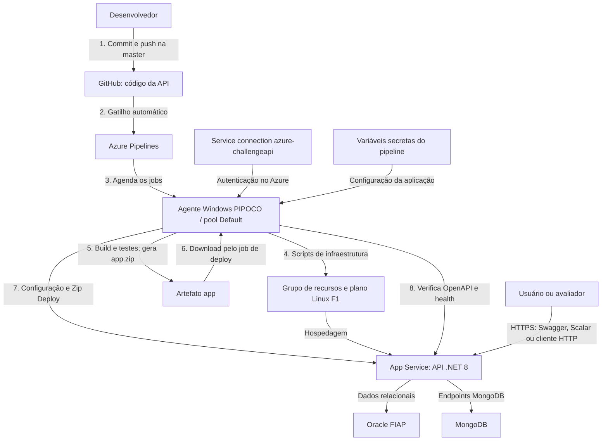

# ChallengeAPI — Sprint 4 DevOps

API em ASP.NET Core 8 para gerenciamento de tutores, pets, consultas e vacinas. A branch `master` reúne a aplicação, os testes automatizados, os scripts de infraestrutura e o pipeline de publicação no Azure App Service.

O Oracle armazena os dados relacionais. A aplicação também possui endpoints específicos para pets no MongoDB. A entrega de DevOps automatiza a preparação dos recursos, a compilação, os testes e a publicação de alterações enviadas à `master`.

## Funcionalidades

- Cadastro, consulta, atualização e exclusão de tutores, pets, consultas e vacinas.
- Filtros de consulta, como nome do tutor, espécie do pet e veterinário da consulta.
- Endpoints de pets no MongoDB e de verificação dessa integração.
- Geração de token JWT e endpoint protegido para validar a autenticação.
- Documentação interativa com Swagger e Scalar.
- Verificação de saúde da aplicação e da conexão Oracle.
- Rota `/versao` para identificar uma alteração publicada pelo pipeline.

A autenticação é aplicada aos endpoints marcados com `Authorize`; a existência de JWT na aplicação não significa que todas as rotas exigem token.

## Tecnologias

| Componente | Tecnologia |
| --- | --- |
| API | C#, .NET 8 e ASP.NET Core |
| Persistência relacional | Entity Framework Core e Oracle |
| Persistência documental | MongoDB.Driver |
| Autenticação | JWT Bearer |
| Documentação | Swagger/OpenAPI e Scalar |
| Logs e telemetria | Serilog e OpenTelemetry |
| Testes | xUnit, Moq e WebApplicationFactory |
| Automação | Azure Pipelines, Azure CLI e PowerShell |
| Agente | Windows, self-hosted |
| Hospedagem | Azure App Service Linux, plano F1 |

## Arquitetura e fluxo de entrega



O agente Windows executa as tarefas de automação. A API é executada no App Service Linux. O pipeline utiliza uma conexão de serviço para acessar o Azure e variáveis secretas para fornecer as configurações sensíveis.

## Estrutura do projeto

| Caminho | Responsabilidade |
| --- | --- |
| `Program.cs` | Configuração da aplicação, serviços, autenticação, documentação e health check |
| `Controllers/` | Endpoints HTTP |
| `Models/` | Modelos de dados |
| `Data/` | Contexto do Entity Framework Core |
| `Migrations/` | Migrações do modelo relacional |
| `Repositories/` | Acesso aos dados MongoDB |
| `Services/` | Serviços da aplicação, incluindo geração de tokens |
| `Settings/` e `SettingsJWT/` | Classes de configuração |
| `Telemetry/` | Métricas e instrumentação |
| `ChallengeAPI.UnitTests/` | Testes unitários |
| `ChallengeAPI.IntegrationTests/` | Testes de integração |
| `scripts/` | Automação de infraestrutura e configuração |
| `azure-pipelines.yml` | Definição do pipeline |
| `docker/` | Arquivos para execução em contêiner |

## Endpoints principais

| Rota | Operações |
| --- | --- |
| `/api/Tutores` | Listagem e cadastro de tutores |
| `/api/Tutores/{id}` | Consulta, atualização e exclusão de um tutor |
| `/api/Pets` e `/api/Pets/{id}` | CRUD de pets |
| `/api/Consulta` e `/api/Consulta/{id}` | CRUD de consultas |
| `/api/Vacinas` e `/api/Vacinas/{id}` | CRUD de vacinas |
| `/api/MongoPet` e `/api/MongoPet/{id}` | CRUD de pets no MongoDB |
| `/api/MongoTest` | Verificação da integração MongoDB |
| `/api/Auth/login` | Geração de token |
| `/api/Auth/dados-protegidos` | Exemplo de acesso autenticado |
| `/swagger` | Interface Swagger |
| `/swagger/v1/swagger.json` | Documento OpenAPI |
| `/scalar/v1` | Interface Scalar |
| `/health` | Estado de saúde e verificação Oracle |
| `/versao` | Versão e mensagem da publicação |

Os parâmetros, corpos das requisições, filtros adicionais e respostas estão descritos na documentação interativa da API. A rota `/versao` retorna um valor definido no código; ela não calcula automaticamente a versão a partir do commit.

## Recursos no Azure

Os nomes utilizados pelos scripts PowerShell estão centralizados em `scripts/config.ps1`.

| Configuração | Valor |
| --- | --- |
| Grupo de recursos | `rg-challengeapi-sprint4` |
| Plano | `plan-challengeapi-sprint4` |
| Web App | `clyvovet-api-rm562156` |
| Região | `brazilsouth` |
| SKU | `F1` |
| Runtime | .NET 8 em Linux |
| Comando de inicialização | `dotnet ChallengeAPI.dll` |
| Service connection | `azure-challengeapi` |
| Pool de agentes | `Default` |
| Agente | `PIPOCO` |

O Oracle e o MongoDB são serviços externos à infraestrutura criada por esses scripts. O pipeline configura o acesso a eles, mas não provisiona os bancos nem executa migrações automaticamente.

## Scripts PowerShell utilizados pelo pipeline

| Arquivo | Função |
| --- | --- |
| `config.ps1` | Define os recursos e a função que executa Azure CLI verificando o código de saída |
| `01-criar-grupo.ps1` | Cria o grupo de recursos quando ele ainda não existe |
| `02-criar-plano.ps1` | Cria o plano Linux F1 ou valida o plano existente |
| `03-criar-webapp.ps1` | Cria ou reutiliza o Web App, configura .NET 8, inicialização e HTTPS |
| `04-configurar-api.ps1` | Aplica as configurações da API a partir das variáveis de ambiente |
| `05-verificar-api.ps1` | Verifica o documento OpenAPI e o estado Healthy do endpoint de saúde |

Os scripts de infraestrutura reutilizam os recursos existentes quando compatíveis. O script do plano interrompe a execução se o recurso existente não for Linux F1. O script do Web App verifica se ele pertence ao plano esperado.

O script `04` exige a conexão Oracle e uma chave JWT de pelo menos 32 bytes. Quando uma conexão MongoDB é informada, também exige o nome do banco. Quando ela é omitida, preserva as configurações MongoDB existentes no App Service. O arquivo temporário usado para enviar as configurações recebe acesso restrito ao usuário Windows que executa o agente e é removido ao final.

O script `05` realiza até 12 tentativas por endpoint, com intervalos de 10 segundos entre falhas. A verificação automática de saúde cobre o Oracle; ela não substitui um teste dos endpoints MongoDB ou do CRUD completo.

### Scripts Bash e implantação anterior

Os arquivos numerados `01` a `05` com extensão `.sh`, junto de `config.sh`, compõem a alternativa Bash para o fluxo de App Service. O pipeline atual chama os arquivos `.ps1`.

`setup-azure.sh` e `delete-azure.sh` pertencem à implantação anterior em máquina virtual e utilizam o grupo `rg-challengeapi`. O primeiro provisiona uma VM e instala ferramentas de contêiner; o segundo solicita confirmação para excluir esse grupo inteiro. Eles não fazem parte do pipeline da Sprint 4 e não gerenciam o grupo `rg-challengeapi-sprint4`.

## Pipeline CI/CD

O arquivo `azure-pipelines.yml` configura o gatilho para a branch `master`, com agrupamento de alterações por `batch: true`. O gatilho de pull request está desativado no YAML.

### 1. Infraestrutura

Executa os scripts PowerShell `01`, `02` e `03` usando tarefas `AzureCLI@2`. O nome do Web App é disponibilizado como variável de saída para o deploy.

### 2. Build, testes e artefato

Após a infraestrutura concluir com sucesso, o pipeline:

1. Limpa a pasta de publicação anterior do agente.
2. Prepara o SDK .NET 8.
3. Restaura as dependências da solução.
4. Compila em `Release`.
5. Executa os testes unitários e de integração e publica seus resultados.
6. Publica o projeto da API.
7. Compacta a aplicação em `app.zip` e publica o artefato `app`.

### 3. Deploy

Após as etapas anteriores concluírem com sucesso, e somente na `master`, o pipeline baixa o artefato da mesma execução, aplica as configurações com o script `04`, publica com `AzureWebApp@1` por Zip Deploy e executa o script `05`.

Todos os jobs exigem o agente Windows `PIPOCO` no pool `Default`. O agente precisa estar online para receber os jobs. Quando executado interativamente por `run.cmd`, sua janela deve permanecer aberta.

## Configuração do pipeline

No Azure DevOps, configure a conexão Azure Resource Manager `azure-challengeapi` com permissão sobre os recursos utilizados e autorize o pipeline a utilizá-la. Na configuração desta entrega, a autenticação usa federação de identidade de carga de trabalho.

Cadastre as seguintes variáveis no pipeline:

| Variável | Uso | Tratamento |
| --- | --- | --- |
| `OracleConnection` | String de conexão Oracle | Obrigatória e secreta |
| `JwtSecretKey` | Chave de assinatura JWT | Obrigatória e secreta; mínimo de 32 bytes |
| `JwtIssuer` | Emissor do token | Padrão do script: `ChallengeAPI` |
| `JwtAudience` | Público do token | Padrão do script: `ChallengeAPI` |
| `MongoConnection` | String de conexão MongoDB | Secreta; opcional para preservar a configuração existente |
| `MongoDatabase` | Nome do banco MongoDB | Obrigatório quando `MongoConnection` é fornecida |

O YAML repassa esses valores como variáveis de ambiente ao script `04`, que grava as configurações correspondentes no App Service. Valores reais de credenciais não devem ser inseridos neste README ou nos scripts.

O agente precisa ter Git, Azure CLI e Windows PowerShell disponíveis. O SDK .NET 8 é preparado pela tarefa `UseDotNet@2`. Caso os nomes do agente, pool, conexão de serviço ou recursos mudem, atualize o YAML e `scripts/config.ps1` conforme necessário.

## Execução local da API

Requisitos: SDK .NET 8, acesso ao Oracle com o esquema da aplicação preparado e MongoDB configurado para utilizar os endpoints documentais.

Na pasta da solução, configure as credenciais localmente com User Secrets. Substitua os textos entre `< >` pelos valores do seu ambiente:

```powershell
dotnet user-secrets set "ConnectionStrings:OracleConnection" "<string de conexao Oracle>" --project ChallengeAPI.csproj
dotnet user-secrets set "Jwt:SecretKey" "<chave JWT com pelo menos 32 bytes>" --project ChallengeAPI.csproj
dotnet user-secrets set "Jwt:Issuer" "ChallengeAPI" --project ChallengeAPI.csproj
dotnet user-secrets set "Jwt:Audience" "ChallengeAPI" --project ChallengeAPI.csproj
dotnet user-secrets set "MongoDbSettings:ConnectionString" "<string de conexao MongoDB>" --project ChallengeAPI.csproj
dotnet user-secrets set "MongoDbSettings:DatabaseName" "<nome do banco MongoDB>" --project ChallengeAPI.csproj
```

Execute em ambiente de desenvolvimento para carregar os User Secrets:

```powershell
$env:ASPNETCORE_ENVIRONMENT = "Development"
dotnet restore ChallengeAPI.sln
dotnet build ChallengeAPI.sln --configuration Release
dotnet run --project ChallengeAPI.csproj --no-launch-profile
```

Abra o endereço exibido no terminal acrescentando `/swagger` ou `/scalar/v1`. As tabelas do Oracle precisam existir antes de utilizar os endpoints que acessam o banco; iniciar a API não implica criar o esquema.

## Testes e validação

Para executar os testes automatizados:

```powershell
dotnet test ChallengeAPI.sln --configuration Release
```

Os testes de integração utilizam uma aplicação de teste com banco em memória. Eles verificam o comportamento da API nesse ambiente; a conexão com o Oracle publicado é conferida separadamente pelo health check e pela validação manual.

Para validar a persistência após o deploy:

1. Cadastre um tutor pelo `POST /api/Tutores` e anote o ID retornado.
2. Consulte esse ID pela API e no Oracle.
3. Atualize o tutor pelo `PUT /api/Tutores/{id}` e consulte novamente o banco.
4. Exclua o registro de teste pelo `DELETE /api/Tutores/{id}` e confira que a consulta não retorna linhas.

Exemplo de consulta no SQL Developer, substituindo `123` pelo ID retornado no cadastro:

```sql
SELECT *
FROM "Tutores"
WHERE "Id" = 123;
```

As aspas preservam os nomes de tabela e coluna utilizados pelo modelo no Oracle. Para demonstrar a entrega contínua, altere a resposta de `/versao`, envie o commit à `master`, acompanhe a execução automática e confira a nova resposta após o deploy.
